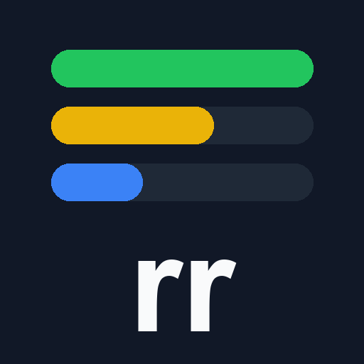

# rich-replies



A Claude Code **mod** that makes Claude's replies richer to read: colored text, task progress bars with expandable details, aligned tables with colored cells, and inline local images. It only changes how assistant messages are drawn; it adds no tools, no commands and no network access.

## Features

### Colored text

Claude writes `<span style="color:...">` and the mod draws the text in that color. Named colors (red, green, yellow, orange, blue, gray, purple, pink, cyan) and any hex value work.

```
Build <span style="color:green">passed</span>, 2 tests <span style="color:#ef4444">failed</span>.
```

### Task progress bars

A fenced block named `gorev` ("task" in Turkish) draws one progress bar per line. Line format: `STATUS-EMOJI PERCENT | task | status | owner | optional details`. Lines starting with `#` are group headings. A `-` instead of a percent means unknown. When a fifth field is present, a `▸` button expands it to `▾` and shows the details.

````
```gorev
# Backend
🟢 100 | Data model | Done | sonnet
🟡 50 | API endpoints | In progress | haiku | Auth is still missing
🔴 - | Flaky test | Blocked
```
````

Add `tablo` to the fence (```` ```gorev tablo ````) or put `#! tablo` as the first line to get a column layout instead of full-width bars. Status emojis: 🟢 🟡 🔵 🟣 ⚪ 🔴.

### Aligned tables

GFM tables that contain colored spans or status emojis are drawn as a fixed-width grid with a bold header, so colors line up. Other tables are left as they are.

### Inline local images

An image on its own line with an absolute local path is shown inside the reply:

```


```

PNG, JPEG, GIF and WebP are supported. Web addresses (`http:`/`https:`) are never fetched and stay as plain text.

## Surfaces

- **VS Code extension:** colors, progress bars, tables and images (images are embedded as an SVG data URI).
- **Terminal:** colors, progress bars, tables and images (drawn with the terminal image component where the terminal supports it).
- **Desktop app:** loads mods that use the same message hooks; behaviour follows what the host supports.

## Limits

- VS Code ignores hover tips and draws buttons as a label only, so details open by clicking `▸`, never on hover.
- Images: the file must be at most about 98 KB (an embedding limit of the VS Code surface) and are scaled down to at most 640 px wide. Larger or unreadable files stay as the original Markdown text.
- Claude Code limits one drawing to about 256 KB; very long messages fall back to plain text.
- Only drive-letter absolute paths (`C:\...`) are recognised for images, and only when the image is alone on its line.

## What the mod reads, sends and fetches

- **Reads:** the text of assistant replies (to find the markup above) and, only when a reply contains an image line with a local path, that one image file through `$.fs.read`.
- **Sends / fetches:** nothing. There are no network requests, no telemetry, no subprocesses and no writes to disk.
- Details: [PRIVACY.md](PRIVACY.md), [TERMS.md](TERMS.md).

## Install

```bash
/plugin install rich-replies
```

Once listed in the directory this is the whole install; before that, test it locally with `claude plugin validate .` and load the folder as a dev mod. Restart Claude Code afterwards.

## Develop

See [CONTRIBUTING.md](CONTRIBUTING.md). Run `claude plugin test .` for the tests. Issues: https://github.com/ahmetbahadiryilmaz/rich-replies/issues

## License

[MIT](LICENSE) © 2026 Ahmet Bahadır Yılmaz

---

# Türkçe

**rich-replies**, Claude'un cevaplarını daha okunur çizen bir Claude Code modudur: renkli yazı, ilerleme çubuklu görev listeleri (tıklayınca açılan ayrıntılarla), renkli hücreli hizalı tablolar ve satır içi yerel resimler. Yalnızca asistan mesajlarının ekranda nasıl çizildiğini değiştirir; araç, komut veya ağ erişimi eklemez.

- **Renkli yazı:** `<span style="color:green">geçti</span>` biçiminde yazılan metin o renkle çizilir.
- **Görev çubukları:** `gorev` adlı kod bloğunda her satır `🟢 100 | Görev | Durum | Kim | ayrıntı` biçimindedir; `#` ile başlayan satır grup başlığıdır. Fence'e `tablo` eklemek (`gorev tablo`) sütunlu görünüm verir. Beşinci alan varsa `▸` düğmesi ayrıntıyı açar.
- **Tablolar:** renkli span veya durum emojisi içeren tablolar sabit genişlikli ızgara olarak çizilir.
- **Resimler:** kendi satırında duran `` yerel resim olarak gösterilir (PNG, JPEG, GIF, WebP).
- **Yüzeyler:** VS Code, terminal ve masaüstü uygulaması.
- **Sınırlar:** VS Code'da hover çalışmaz, düğme yalnız etiket çizer; resim en çok yaklaşık 98 KB ve 640 piksel genişliğe indirilir; tek çizim yaklaşık 256 KB ile sınırlıdır.
- **Neyi okur:** yalnızca cevap metnini ve, cevapta yerel yol içeren bir resim satırı varsa, o dosyayı `$.fs.read` ile. Hiçbir şey göndermez, indirmez, kaydetmez ve ağa çıkmaz.
- **Lisans:** MIT.
